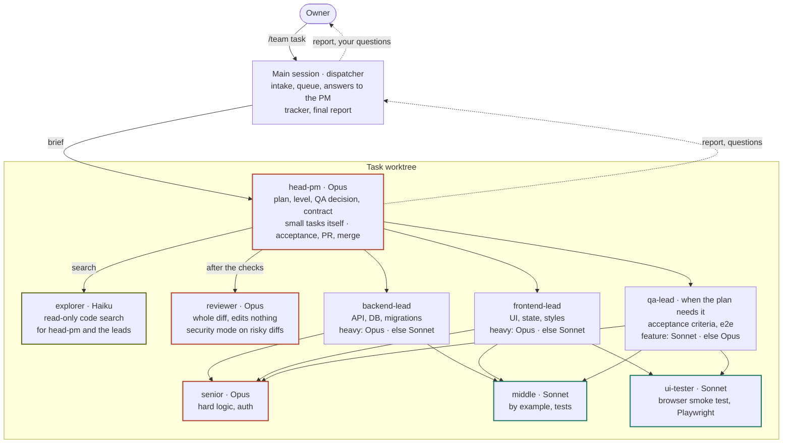

# AI dev team for Claude Code

Type `/team <task>` in any git repo and walk away. You get a PR from a `team/<task>` branch and one report: what was done, decisions made without you, and the few questions only you can answer, each with a default. Your branches and working copy stay untouched; nothing is merged unless you turn on [merge mode](#merge-mode).

The team is installed once per machine, into `~/.claude`, as links to this repo. Projects need nothing in git.

## How it works



Every agent in the worktree runs under the [guard](#good-to-know). The PM reads the code, picks the level and launches only the agents the plan needs:

| Level | When | Who writes code | Leads, QA lead |
| --- | --- | --- | --- |
| `small` | 1–2 files of product code (tests don't count), obvious solution — even if risky or you asked for "full team" / "on Opus" | the PM | frontend lead verifies on Sonnet, or QA lead on Opus if QA runs |
| `feature` | everything else | leads, middle when needed | Sonnet |
| `heavy` | new project or module, architecture decision, cross-cutting refactor, a change to how auth, sessions or permissions work, payments, new personal data, file uploads, secrets, schema change, migration or one-off data operation, concurrency, bug with no hypothesis; or you wrote "full team" / "on Opus" | leads, senior, middle | Opus |

The level only goes up: a `heavy` trigger found later, or a `feature` lead stuck for two rounds, and the PM relaunches that part on Opus. QA is always in the plan for auth, sessions, permissions, payments, personal data, file uploads, secrets, a backend↔frontend contract or a migration.

```
branch → plan (criteria, level, QA) → contract (backend + frontend) → code → acceptance
       → QA (if planned) → review → rework, re-check, re-review → PR → merge (merge mode, green CI)
```

Rework gets two rounds per bug; on `feature` the level is raised first, then the bug goes under "Blocked".

Tasks branch off `develop` when `origin/develop` exists, otherwise off the default branch. Releases and deploys are never part of a task.

## Install

1. `claude update` (v2.1.219+: subagents launch subagents) and install `node` — the installer and hooks run on it.
2. `git clone <this repo's URL> ~/dev-team`
3. From your own terminal, not through Claude: `node ~/dev-team/install.mjs`. It links the agents, skills and rule into `~/.claude`, sets `CLAUDE_CODE_MAX_SUBAGENT_SPAWN_DEPTH=3` in `~/.claude/settings.json` and adds `.claude/worktrees/`, `.claude/agent-memory-local/`, `.team/` to your global git ignore. It checks everything first; on any conflict it changes nothing.
4. `gh auth login` — the PM opens PRs with `gh`; without it a task ends at a pushed branch.
5. `{ "permissions": { "defaultMode": "auto" } }` in your **user** `~/.claude/settings.json` (a project file can't set it), or launch with `--permission-mode auto`. With `acceptEdits` every engineer's Bash command becomes a prompt to you; `bypassPermissions` only in an isolated container.
6. New `claude` session: `/agents` lists `dev-team-*`. In a repo with an `origin`, type `/team <task>`.

**Update:** `git -C ~/dev-team pull`; re-run the installer only when the team adds, drops or renames a file. The checkout is live — switching its branch switches the team everywhere, so experiment in a separate worktree of this repo.
**Uninstall:** `node ~/dev-team/install.mjs --uninstall` removes its links and settings changes; the global ignore lines stay.

<details>
<summary>Migrating from the old per-project install</summary>

In such a project delete `.claude/agents/{head-pm,backend-lead,frontend-lead,qa-lead,senior-engineer,middle-engineer,reviewer,ui-tester}.md`, `.claude/skills/{team,team-protocol,api-contract,auth-safety,integrations}/`, `.claude/hooks/{guard-push,sync-memory}.mjs`, `.claude/dev-team.json`, the team block in `.claude/CLAUDE.md`, the team's hooks, `env` and permissions in `.claude/settings.json`, and its line in `.worktreeinclude`. Rename lead memory `.claude/agent-memory-local/<lead>` → `dev-team-<lead>`; committed `.claude/agent-memory/` — copy it there and `git rm -r --cached` it.

</details>

## What the project CLAUDE.md needs

Nothing is required: without it the PM finds commands in `package.json`, `Makefile` or the README. With it results are more precise and cheaper. List the verification commands — install without rewriting the lockfile (`npm ci` and equivalents), tests, linter, types, build; acceptance depends on them. For a web UI add the run command, URL and a test login (no real secrets); for a mobile app the team lists scenarios for you to check on a device. Nice to have: example files, stack, structure.

```markdown
## Commands
- Install: `npm ci`
- Tests: `npm test` · Lint: `npm run lint` · Types: `npm run typecheck` · Build: `npm run build`
- Run: `npm run dev` → http://localhost:3000, test login: `npm run seed` creates demo@example.com
```

## Usage

`/team <task>`, several separated by `;`. Without `/team`, `claude` is a normal session (unless a CLAUDE.md has `dev-team: self-launch`, see `rules/dev-team.md`). The report comes in the language of your task and has "Questions for you", each with a default: answer briefly ("1 — yes, 3 — option B") and the PM reworks the same PR. Rework after a merge is a new `/team` task. Decisions go to `.team/decisions.md` in the task's worktree and into the PR description.

By default up to 3 tasks run at once, each in its own worktree ([`TEAM_MAX_TASKS`](#customization)). Tasks that touch the same files start together on their own only in merge mode; without it the team warns you and waits until you say "now" or "after <task>".

## Merge mode

Off by default: the team opens PRs, you merge them. To turn it on, put this into the project's `.claude/settings.local.json` (not committed) and start a new session; `/team` then prints "merge mode: on" in its first line. Remove the line and start a new session to turn it off.

```json
{ "env": { "TEAM_MERGE_BRANCH": "develop" } }
```

- **Value:** `develop`, or the default branch when there's no `develop`. `master`/`main` in a repo with `develop` means: merge into `develop`, then fast-forward `master`/`main` to that merge. Never a branch that deploys on push; any other value merges nothing.
- **When:** review has no critical/major findings, planned QA passed, no test skipped, CI is green (if the PR has checks), nothing is blocked, and the branch has caught up with the base (and `master`/`main` when promoting) — conflicts resolved, checks green again. Open questions don't block the merge.
- **How:** a merge commit. In a public repo the PM fast-forwards the base to the PR head instead: a GitHub merge commit would carry your name and email.
- **Never merged:** a PR that touches `.claude/`, `.github/`, `.husky/`, `.mcp.json` or `.worktreeinclude`.
- **Promotion** is fast-forward only: if `master`/`main` moved, or would get protected files from `develop`, the report says "not promoted" and you promote by hand.
- **Rollback:** `git revert -m 1 <merge sha>` from the report, newest first; after a fast-forward, revert the commits the report lists.

The guard catches agent mistakes, not a hostile agent: agents run with your GitHub credentials. For a hard guarantee use a bot account and branch protection.

## Multi-repo workspace

One session for several repos kept side by side in a plain folder that isn't a git repo. `/team` picks each task's repo from the ticket and asks when unclear; tasks for different repos run in parallel.

<details>
<summary>Setup</summary>

```
~/work/acme/                      ← run claude here
├── .claude/settings.json         ← the WorktreeCreate hook
├── backend/                      ← git repos, each with an origin
├── frontend/
└── .team-worktrees/agent-<id>/   ← task worktrees, made by the team
```

1. Add the hook to `<workspace>/.claude/settings.json`:
   ```json
   {"hooks":{"WorktreeCreate":[{"hooks":[{"type":"command","command":"node \"$HOME/.claude/dev-team/hooks/worktree-slot.mjs\""}]}]}}
   ```
2. Launch `claude` in the workspace interactively once and trust the folder: hooks of an untrusted folder don't run.
3. Merge mode is per repo: the `TEAM_MERGE_BRANCH` line goes into `<repo>/.claude/settings.local.json`; the workspace's own env is ignored, so a repo without the line has merge mode off.

The hook gives each isolated agent an empty slot; the PM turns it into a worktree of the task's repo and copies the repo's `.worktreeinclude` files. Sessions opened inside a repo are unaffected.

</details>

## Customization

- **Parallel tasks.** `TEAM_MAX_TASKS` in the `env` of `~/.claude/settings.json`, 3 when unset. Each task installs, builds and tests in its own worktree: raise it only where cores, memory and disk allow, then start a new session.
- **Cost.** Seniority is `model` + `effort` in the agents' frontmatter; on `feature` the PM passes the Agent `model: "sonnet"` parameter to the leads and the QA lead. Cheaper still — senior on `sonnet`, leads on `effort: medium`. With `CLAUDE_CODE_SUBAGENT_MODEL` set, Claude Code before 2.1.251 ignores the parameter; `CLAUDE_CODE_SUBAGENT_MODEL_FORCE=1` or a mod's `agent.spawn` hook overrides it too.
- **New department.** Copy `agents/dev-team-backend-lead.md` to `agents/dev-team-<name>-lead.md`, rewrite `name`, `description`, "Scope" and "Who does what", keep the `hooks:` block (it puts the guard on the agent). Add the department to `dev-team-head-pm.md` (first paragraph and "You launch only"), the "Hierarchy" line of `dev-team-protocol` and the [diagram](#how-it-works), then re-run the installer.
- **Stack knowledge.** Skills in a project's `.claude/skills/`, or `skills/dev-team-*` here plus the agents' `skills:` field for every project. Only what the code doesn't show, under 60 lines.
- **Deploy CLIs** the team must never run (`vercel --prod`, `fly deploy`, …): add them to `BANS` in `hooks/guard.mjs`, or to `permissions.deny` in a project's `.claude/settings.json`.

## Good to know

- **The guard** lets only the PM push its `team/*` branch, open a PR and, in merge mode, merge it and fast-forward `master`/`main`. Every other push and `gh` call is blocked, except read-only ones (`gh pr view`, `gh pr checks`, …), and so are publishing, cluster and infrastructure changes, hook bypass, `git stash`, and `.env` files (not `.env.example`), `*.pem`, `secrets/`. `git push`, the word `gh` and secret paths trip it even inside quotes and heredocs, the other bans skip quoted text — put such text in a file with Edit. Team agents only: the main session relies on the rules file and `auto` mode. The ban on recording new work (tickets, issues, follow-up PRs) lives in the prompts. A safety net, not a [sandbox](https://code.claude.com/docs/en/sandboxing).
- A worktree has only tracked files: list the `.env` that `dev-team-ui-tester` needs in [`.worktreeinclude`](https://code.claude.com/docs/en/worktrees). No browser for the tester — `npx playwright install chromium`.
- `auto` mode pauses and starts asking after 3 classifier blocks in a row or 20 per session; lead memory writes under `.claude/` go through it. Overnight — keep the Mac awake.
- A task's worktree (`.claude/worktrees/agent-<id>`) stays so the PM can be resumed; remove it after the merge with the report's commands.
- The queue lives in the main session: a restart loses tasks that hadn't started — resend them.
- Lead memory is per machine: `.claude/agent-memory-local/` in each project, git-ignored.
- Don't install agent collections (e.g. VoltAgent) globally: team agents would see them. A project agent named like a team agent replaces it in that project.
- Your `~/.claude/CLAUDE.md` loads into every team agent: keep it small, without process rules like "always ask the user".

## What's inside

<details>
<summary>Files of this repo</summary>

| Path | Purpose |
| --- | --- |
| `agents/` | The diagram's agents as `dev-team-<name>.md`; senior and middle are `dev-team-senior-engineer.md`, `dev-team-middle-engineer.md`. Leads break work down, delegate, review and integrate. `dev-team-explorer` replaces the built-in `Explore` so the guard covers it |
| `rules/dev-team.md` | Team boundaries, loaded in every session (the `auto` mode classifier sees them too) |
| `skills/team/` | `/team`: intake, queue, answers, final report. Owner-only |
| `skills/dev-team-*/` | Shared protocol, backend ↔ frontend contract, auth and webhook checks |
| `hooks/guard.mjs` | The guard, see [Good to know](#good-to-know) |
| `hooks/sync-memory.mjs` | Copies lead memory from a task's worktree back to the main checkout |
| `hooks/worktree-slot.mjs` | `WorktreeCreate` hook of a [multi-repo workspace](#multi-repo-workspace): an empty slot per isolated agent |
| `hooks/slot-init.mjs` | Run by the PM: turns its slot into a worktree of the task's repo on the base |
| `hooks/merge-branch.mjs` | Merge mode's base for a checkout, shared by the guard, the PM and `/team`: the env in a single repo, the repo's own settings in a multi-repo workspace |
| `templates/design-system/` | Design system skill template — copy into a project's `.claude/skills/design-system/` |
| `install.mjs` | Links the team into `~/.claude` |

</details>
